# Design

homepaper has two surfaces: the **panel** (800 × 480, 1-bit, or 4 greys in grey mode) and the **web UI** where the user lays it out. Both follow one design language ([D-014](decisions.md#d-014)). The panel redesign is [D-015](decisions.md#d-015).

**Status (2026-11-16):** both designs are agreed. Both are implemented. The renderer reproduces `design/hero-*.png` pixel for pixel (`TestGolden`), and the web UI follows the tokens below (`server/web/ui/src/style.css`).

## Shared language (D-014)

The panel's constraints set the rules, and the web UI borrows the panel's numbers wherever the renderer has one.

| Token | Value | Panel | Web UI |
|---|---|---|---|
| Ink | `#111111` | black | text, 2 px rules, primary buttons |
| Sheet | `#FFFFFF` | white | cards, inputs, preview |
| Paper | `#F3F2EC` | – | page ground |
| Muted | `#55554F` | – | secondary text only (7:1 on white) |
| Editor blue | `#1D4ED8` | **never** | selection, grid guides, focus, links: everything that never reaches the panel |
| Danger | `#B42318` | – | errors and delete, always with words |
| Stroke | 2 px | widget frames, rules | cards, inputs, buttons, rules |
| Radius | 8 px | widget frames | cards, inputs, buttons (dialogs 12) |
| Type sizes | 12, 14, 17, 20, 25, 34, then whole px | Lucida bitmaps, Go Bold above | the same scale, set in the Go fonts |

- **Typeface.** The panel uses Lucida Sans bitmaps up to 34 px and the Go fonts above ([P-013](decisions.md#p-013)). The web UI uses the Go fonts throughout (served at `/api/fonts/…`), and Go Mono for IDs, tokens and URLs. Bigelow & Holmes drew both families, so they match. The Lucida BDFs are never converted for the web (their license).
- **Patterns, not greys.** Where a web UI would use grey, use a 1-bit dot screen (dialog backdrop, demo state) or a hatch (placeholders). Dialogs get a hard 6 px offset shadow, no blur.
- **Fill carries state, not hue.** Status dots: solid = online and in sync, half = catching up, hollow = offline, dotted = not connected yet or demo data, red with a slash = Home Assistant unreachable.
- **Rules.** Solid 2 px for structure, dotted 2 px for rows inside a card, dashed for empty slots and warnings.
- **Icons.** A 24 px grid with 2.5 px strokes in the UI; solid shapes and thick strokes on the panel. A UI icon is the outline twin of the panel icon.

## Web UI

The structure stays as built (header with display tabs, Layout/Display switch, editor with inspector, dialogs). The design defines the look and adds these details:

- **Header:** display tabs with status dots, "Add display", the Home Assistant status in three states (demo, connected with the entity count, unreachable; not clickable since [D-016](decisions.md#d-016)), and the logged-in user with "Log out".
- **Layout view:**
  - The preview sits in a black bezel (a picture frame), with the effective grid (8 × 6 on the full panel) as blue guides while a widget is moved or resized.
  - Widgets get blue kind tags. The selected one has a blue outline and a resize handle.
  - Problems get a dashed red outline and a red flag ("Choose an entity", "Entity not found").
  - The title row shows the status and the time of the last frame.
- **Inspector:**
  - The kind icon, the size in cells, and the form built from the schema.
  - The entity picker shows the name, the ID in mono and the live state, with search and domain chips.
  - Multi-entity fields are an ordered list with drag handles.
  - Short select lists are radio cards, long ones a dropdown. Numbers get a −/+ stepper.
  - Required fields are marked "Required".
- **Live preview:** the preview is a virtual display that receives the panel's own frames pushed, without the panel's rate limit. Refreshed regions flash a blue outline, and a status line under the bezel names the last frame.
- **Colours:** a Black/white | 4 greys switch in the editor toolbar sets the layout's grey mode ([D-018](decisions.md#d-018)). It is disabled, with a tooltip, when the display reports a 1bpp panel.
- **Dividers:** a Rules/Frames switch in the editor toolbar sets the layout's dividers ([D-015](decisions.md#d-015)). The design canvas had no place for it; the toolbar is the implementation's choice.
- **Light only:** the old editor followed the system's dark mode. The design is ink on paper and has no dark variant, so the restyled UI is light only.
- **Display tab:** numbered setup steps, the values to enter by hand (with Copy and Show), a status card with details, and Manage (rename, replace token, delete) with inline confirmation.
- **Display area ([D-021](decisions.md#d-021)):** designed on the canvas "Display area editor".
  - Display tab: a "Display area" card (above the setup steps once the display has connected) with a small bezel picture, the margin hatched in editor blue and the cells dotted; width and height with −/+ steppers (8 px) and "Full panel"; horizontal and vertical offsets (2 px) and "Center"; mm next to the px when the panel's pitch is known; a dashed note when the grid loses columns or rows, with the number of widgets that no longer fit. Values are checked as typed, and nothing changes on the panel until "Apply to the display" (one full refresh). A switch draws a 1 px edge line on the panel for calibration.
  - Layout view: the preview still shows the whole panel; the margin is hatched in editor blue, the grid guides cover only the area, and a blue chip in the toolbar ("Area 600 × 432 · 7 × 6 cells") leads to the Display tab. While the edge line is on, a dashed banner offers "Turn off".
  - Broken widgets: a red dashed outline with a "Doesn't fit" flag where the widget would sit (often over the margin), a red-bordered "Doesn't fit at this display size" list under the preview with Place, Edit and Delete, and a red notice in the inspector with the reason and Place. On computers the editor has no separate widget list, so the plan's "mark them in the widget list" is covered by the outline and the list. On phones the widget list marks them too (see Phones).
- **Phones ([D-022](decisions.md#d-022)):** designed on the canvas "homepaper mobile concepts", Concept B. At 700 px wide and below the UI keeps every function and changes how it is reached:
  - Header: the display tabs scroll in their own row; the Home Assistant status keeps its dot and drops the entity count.
  - Layout view: the toolbar becomes a bottom bar with Undo, Redo, Options (Dividers, Colours, the display area chip, Actual size) and Add widget. The preview can't be dragged; a tap selects a widget. Under the preview a **widget list** names every widget with its kind icon and size, with "Choose an entity", "Entity not found" and "Doesn't fit" in red. The list takes the place of the shortcut hint.
  - Widget sheet: with a widget selected, the inspector opens in place of the list, styled as a sheet (rounded top, hard shadow) with the preview pinned above it. It adds Move (four arrow buttons) and Size (width and height −/+), which step by one cell like the arrow keys, then the schema form, Duplicate and Delete. "Done" returns to the list.
  - Add widget: a sheet with a three-column grid of the kinds; the widget goes into the first free spot, as on computers.
  - Entity picker: opens full screen with a Back button, the search, the domain chip and the whole list.
  - Inputs and selects are 17 px so iOS doesn't zoom on focus; touch targets are at least 44 px.
- **Dialogs:** Add display. The Home Assistant dialog of the canvas was dropped with [D-016](decisions.md#d-016). The login pages (logged out, no access, login failed) use the same card and hard shadow.

## Panel (D-015)

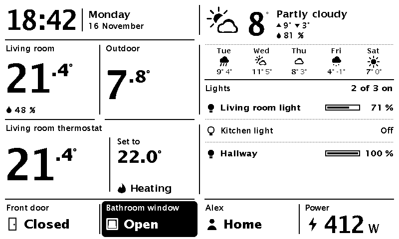

### Principles

- **Values first.** Primary numbers are large, in Go Bold 34–88. Whole degrees are big and the decimal is small and raised ("21" + ".4°"), so the reading works from across the room and the precision is there up close.
- **Three text levels:** values; labels in Lucida 17 (14 in 1-cell widgets); detail in Lucida 14–20. Lucida 12 is for tertiary text only. It is about 1.7 mm tall at the panel's ~124 dpi.
- **Rules, not boxes.** The default divider is a 2 px rule in the gutter between widgets, stopping 10 px short of crossings. Frames (today's look: 2 px, radius 8) remain as a layout-wide option.
- **Inverted means act.** A widget turns black with white content only for states that need action: door, window or garage door open; lock unlocked. Lights, motion and presence never invert. They change often, and large changing black areas ghost under partial refresh.
- **Icons draw the state:** door ajar, window tilted, shackle open, person hollow when away, flame only while heating, bulb filled when on, alarm shield hollow (disarmed), half (arming, pending) or solid (armed, triggered).
- **Calm by default.** Idle is regular weight without an icon. Unavailable is "–" plus "Not available". All lights off says "All off".
- **Alignment.** Single-block widgets (date/time, text, value, temperature, state) can be left-aligned (the default), centred or right-aligned. Label and content move together.
- **Shrink by dropping, not squeezing.** Secondary information goes first, then type steps down. A primary value never goes below 20 px.
- **Small diffs.** The clock is the only per-minute change, about a 160 × 50 px region.

### Widgets

| Kind | Small | Large | Drops first |
|---|---|---|---|
| Temperature | 1×1: label 14, value Lucida Bold 34. One row, 2+ wide: humidity on the value's line at the far edge; the value may step down to 34 to keep it | 2×2+: value 64–88, droplet + humidity at the bottom | humidity |
| Value | 1×1: value + unit at 17 | 2×1+: device-class icon, unit Lucida 25 on the baseline | icon |
| Thermostat | 1 row: "21.4° ▸ 22.0°", action + flame from 4 wide | 2 rows: current 88 left; "Set to", target and action right of a rule | action |
| Weather | 2×1: icon + temperature | 4×2: condition, high/low (▲▼), humidity, 5-day strip | forecast, humidity, high/low, condition |
| Lights | 1 row: header + a row of bulbs | one row per light (≤ 46 px), brightness bars from 3 wide | bars, then names |
| State | 1×1: label 14, icon + word 20 (icon goes if the word doesn't fit) | 2×1: label 17, icon + word Lucida Bold 25. Several entities: one row each, alert rows inverted | icon; in a list, the name before the state (a per-entity label replaces the name, D-023) |
| Departures | 1 row: two departures at 14 px, no heading | heading + "as of"; 34 px rows: line sign, destination, platform (3+ wide), actual time, inverted delay tag | platform, then destination |
| Date / time | time alone: Go Bold 56 | time + rule + day (bold 20) and date (17) stacked | – |
| Text | note: Lucida 17, one line, "..." | heading: Lucida Bold 25 + 2 px rule to the edge | – |

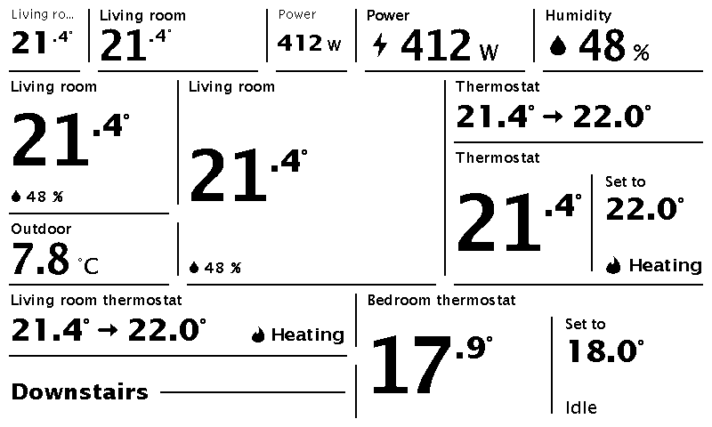
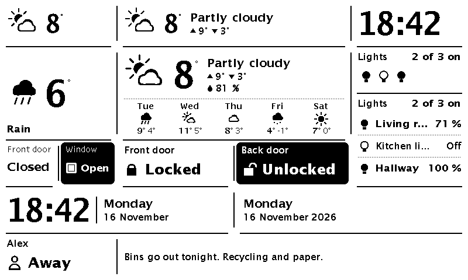

### States

| Calm | Exceptions |
|---|---|
| 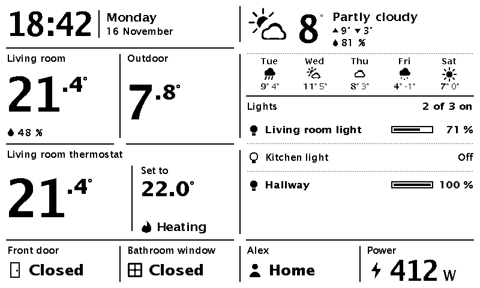 | 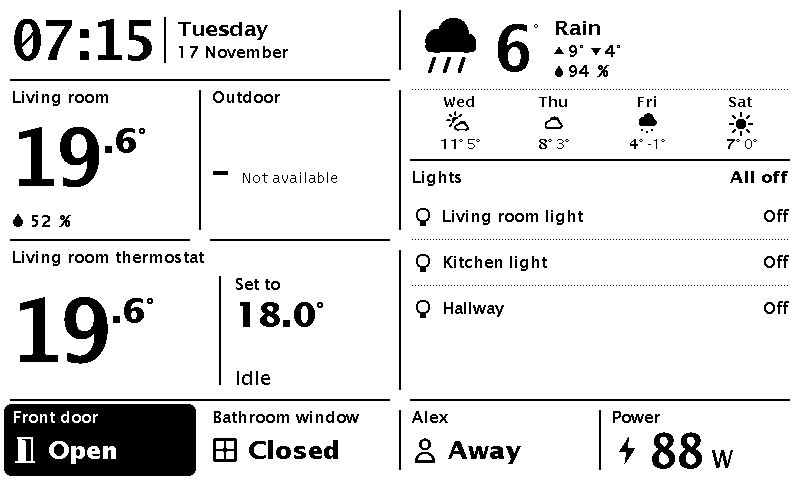 |

Frames instead of rules:

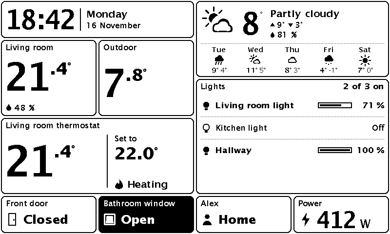

### Type

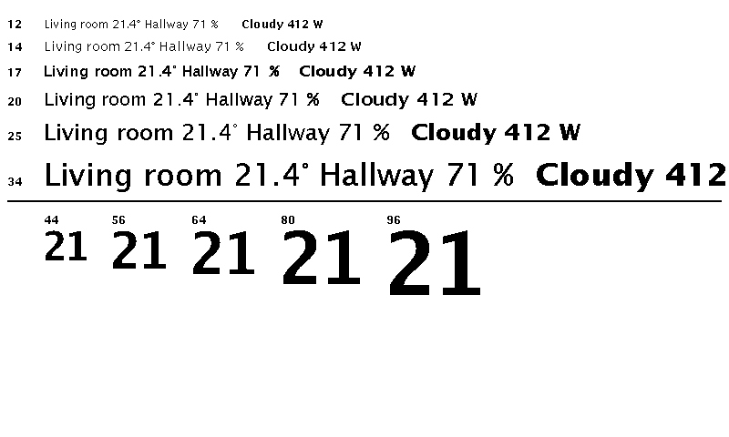

### Implementation

The renderer draws all of this (`internal/render/kinds.go`, `draw.go`; see [rendering.md](rendering.md#panel-design-d-015)). The forecast comes from `weather.get_forecasts`, which the HA client fetches ([D-015](decisions.md#d-015)).

## Panel in 4 greys (D-018)

**Status (2026-11-18):** agreed and implemented as an option per display: "Colours: Black/white | 4 greys" in the editor toolbar, off by default, available when the display reports a 2bpp panel. The panel can show black, two greys and white, but only with a full refresh (2.1 s, flashes), while partial refresh (0.4 s) is black/white only. So a change that touches only black/white pixels goes out as a partial refresh, and a change to any grey pixel triggers a 4-grey full refresh ([D-018](decisions.md#d-018)).

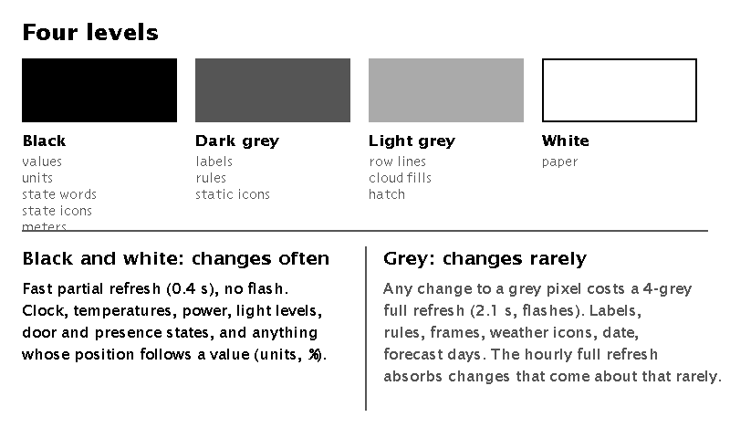

**Rule: grey only where the pixels don't change with entity state or time.** A grey pixel that changes costs a flashing full refresh, so:
- **Black stays** for values, units, state words, state icons (door, window, lock, person, bulb, flame), brightness meters (they appear and disappear with the light) and the inverted alert plate. Units and the `%` follow the width of their value, so they move and stay black too.
- **Dark grey** for widget labels, column rules and frames, the clock and thermostat dividers, "Set to", the date line, forecast day names, heading rules and small fixed icons (humidity droplet, power bolt when left-aligned, high/low triangles).
- **Light grey** for row lines (replacing the 1 px dotted line with a solid 2 px light line), cloud fills, and the hatch behind "Not available".
- **Weather icons** get grey bodies with black outlines: a dark grey sun disc, light clouds for cloudy and snow, dark clouds for rain and thunder. They change a few times a day at most. The date and forecast change daily, which the hourly full refresh absorbs anyway.
- Nothing that changes every minute (clock digits, values) ever sits on a grey ground. That is why there are no grey header bands or tinted widget backgrounds.
- An alert widget turning black or back changes its grey label and the rules beside it, so it costs a full refresh. That is rare, and suits the large black plate anyway.
- The web UI keeps its own rule ("patterns, not greys"); grey mode is about the panel only.

| | |
|---|---|
| 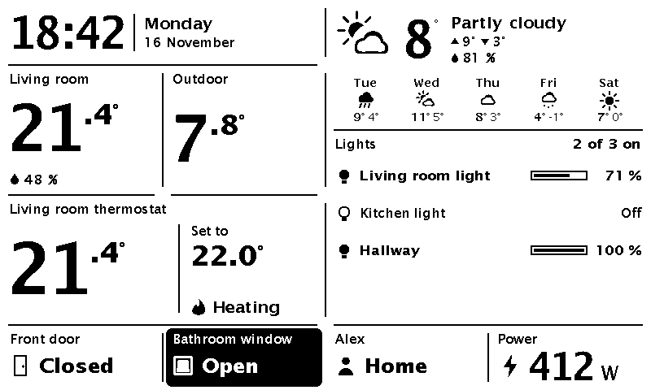 | 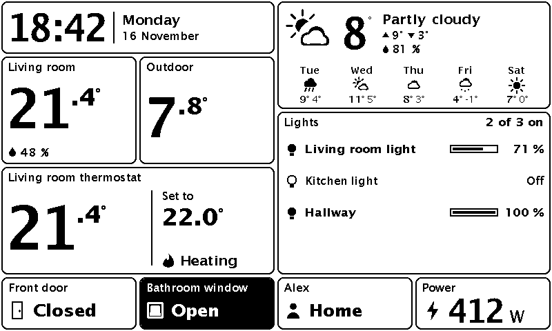 |
| 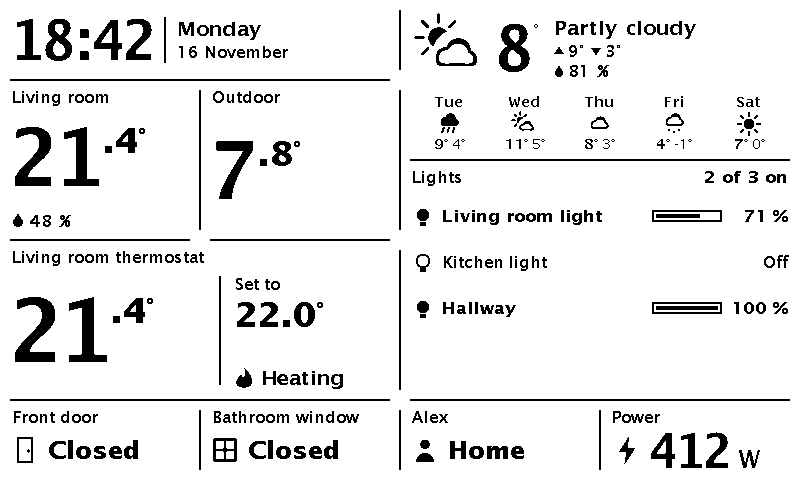 | 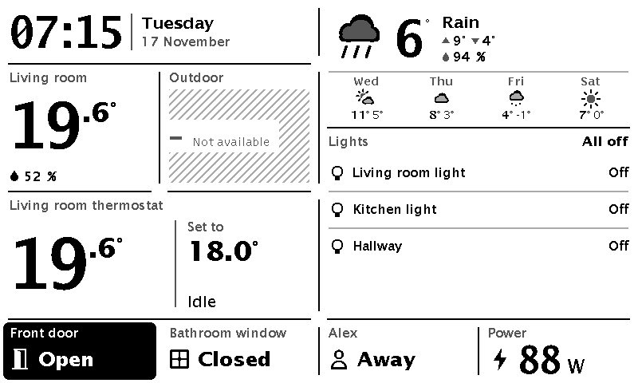 |

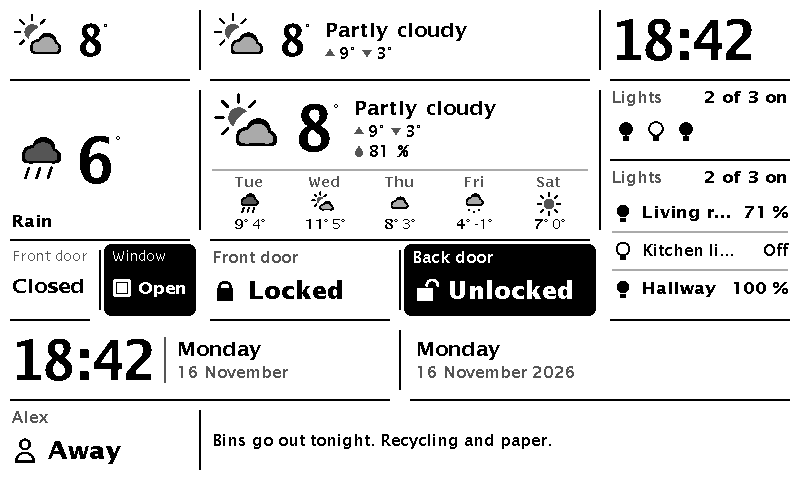

## Mockups

The `grey-*.png` images are 2bpp (palette 0, 85, 170, 255). Grey is drawn on separate coverage layers, each thresholded at 50 % and composed under the black ink, so anti-aliased edges never turn grey. The renderer draws `grey-hero-*.png` (`TestGolden` owns them); `grey-exceptions.png`, `grey-specimen-b.png` and `grey-rules.png` come from the generator (`newGreyM`, `greyicons.go`) and are mockup-only.

The other PNGs in `design/` are true 800 × 480 1-bit images with demo data from `internal/ha/demo.go` (plus an invented forecast). They were drawn with the generator in `design/panelmock/` (its own Go module; `cd docs/design/panelmock && go run .` rewrites the PNGs), which uses the renderer's fonts and pipeline (bitmap and vector faces, whole-pixel text, threshold at 128). The renderer now draws `hero-*.png` identically, and `TestGolden` owns those three images. The other images (specimens, exceptions, type) are still mockup-only. Delete `panelmock/` once nothing needs those images any more.

The web UI design exists as a design canvas only. There are no images of it in the repo.
